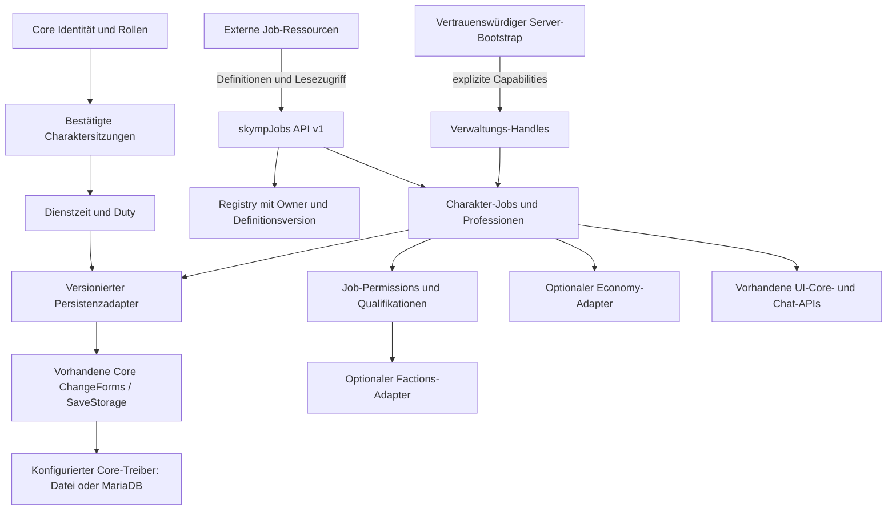

# Architektur

SkyMP-Jobs ist eine Infrastrukturressource. Medizin, Festnahmen, Handel,
Handwerk, Jagd und Bergbau werden von externen Plugins implementiert.

## Module

| Pfad | Verantwortung |
| --- | --- |
| `src/api` | API 1, Daten-/Eventtypen, öffentliche und privilegierte Verträge |
| `src/core/job-registry` | Validierte immutable Definitionen, Eindeutigkeit, Owner und Versionsschutz |
| `src/core/character-jobs` | Mitgliedschaften, primärer Job, Ränge/Spezialisierungen und Transaktionskoordination |
| `src/core/professions` | Eigenständige Professionen, XP-basierte Stufen, Freischaltungen und Qualifikationen |
| `src/core/duty` | Flüchtige Dienstintervalle mit monotoner Serverzeit |
| `src/core/permissions` | Berufliche Rechte, Rang-/Qualifikations-/Duty- und optionale Core-/Faction-Bedingungen |
| `src/core/events` | Nur serverseitige, isolierte Abonnements nach erfolgreicher Speicherannahme |
| `src/persistence` | Schema 2, Migration, CAS-Vertrag und Testadapter |
| `src/integrations` | Auditiertes natives Binding, Host-Vertrag, UI, Chat und optionale externe Services |
| `vendor/sdk` | GPL-SDK-Lifecycle aus dem lokalen Plugin-Template, mit dem Entry gebündelt |

## Fachliche Trennung

Ein Job ist eine Beschäftigung mit Rang und optionalem Dienst. Eine Profession
ist ein erlernter Skill, der unabhängig von Jobs existiert. XP wird bei der
Profession gespeichert; Jobs/Ränge/Spezialisierungen können bestimmte XP oder
Qualifikationen verlangen. Ein Rangwechsel erfolgt bewusst durch einen
Verwaltungs-Handle, nicht automatisch beim Erreichen einer XP-Schwelle.

`maxJobs` zählt alle gespeicherten Mitgliedschaften, auch vorübergehend nicht
verfügbare. Deaktivierung oder Deregistrierung entfernt nur Definitionen und
Funktionalität, niemals gespeicherte Mitgliedschaften oder Profession-XP. Die
erneute passende Registrierung macht diese wieder nutzbar. Fehlende Ränge,
falscher Owner oder eine zu alte Definition verweigern Rechte, ohne Daten umzuschreiben.

## Zeit und Lebenszyklus

Der Core bestätigt User-/Actor-Zuordnung und Profil; der Identitätsadapter liefert
zusätzlich den stabilen Charakter und eine Aktivierungsgeneration. Pro Charakter
darf genau eine Sitzung aktiv sein. Der native Adapter erneuert seine Generation
bei Connect und Datensatzwechsel. Ein Host muss auch den Wechsel desselben
Datensatzes in einen anderen Slot erkennen und eine neue Generation liefern.

Die Konfiguration erlaubt mehrere Jobs und eine begrenzte Anzahl paralleler
Dienstverhältnisse. Doppelte Dienststarts ändern die Startzeit nicht. Ein zentraler
Scheduler schreibt Zeitdifferenzen aus `performance.now()`; große Lücken werden
auf `maxDutyGapMs` begrenzt. Systemuhränderungen erzeugen keine Zeitgutschrift.
Disconnect/Charakterwechsel sperren die alte Sitzung sofort und schließen die
Intervalle. Ein fehlgeschlagener Abschluss behält seinen Endzeitpunkt für den
Wiederholungsversuch. Deterministische Intervall-IDs verhindern doppelte Gutschrift
nach einer verlorenen Speicherbestätigung.

Duty selbst wird nicht als wiederaufzunehmendes Flag gespeichert. Nach Neustart
ist jeder außer Dienst; ein Absturz kann höchstens seit dem letzten angenommenen
Checkpoint erfasste Zeit verlieren. Berufliche Rechte prüft der Permissions-Service
bei jeder Abfrage erneut; Duty allein ist keine Berechtigung. Duty-Abfragen prüfen
auch aktuelle Zugangsbedingungen; der Scheduler beendet einen nicht mehr
berechtigten Dienst mit `access-revoked` spätestens bei seiner nächsten Prüfung.

## Vertrauensgrenze

Die globale API enthält Leseoperationen und Registrierungs-Handles. Nur der
Host-Bootstrap erhält `JobsHostControlsV1` und kann über `provisionResource`
begrenzte Verwaltungs-Handles an vertrauenswürdige Servermodule übergeben. Die
Mengen `manageJobs`, `manageProfessions`, XP-Quellen und `payments` werden kopiert
und eingefroren. Es gibt keine Aufwertung durch `owner`, Command-Parameter oder
Client-Payload. Eigene Duty-/Primärjob-Aktionen sind ausschließlich an die aktuelle
bestätigte Sitzung gebunden und prüfen diese auch nach asynchronen Reads.

Alle Gamemode-Plugins teilen trotzdem einen Node-Prozess, Globals und den
nativen `mp`-Zugriff. Ein bösartiges installiertes Plugin kann APIs überschreiben,
Owner imitieren oder Speicher direkt ändern. Capabilities verhindern versehentliche
oder über Clientkanäle erreichbare Überprivilegierung; sie ersetzen keine
Prozessisolation oder vertrauenswürdige Installation. Core-Rollen bleiben im Core,
Fraktionsdaten bei Factions und Währungen bei Economy.

## Nebenläufigkeit und Fehler

Jede Charaktermutation läuft in einer serialisierten Queue, liest den aktuellen
Speicher und nutzt `compareAndSet`. Eine Speicherablehnung führt zu keinem
Erfolgsereignis. Definitionen, Ressourcenstatus und Spielersitzung werden vor
dem Speichern erneut geprüft. Externe Schreiber benötigen ebenfalls CAS.
Ein Mehrprozess-Host muss zusätzlich Session-Fencing in seine Transaktion aufnehmen.
Events tragen Revisionen und immutable Daten; kaputte Listener beeinflussen die
bereits angenommene Mutation nicht. Ein Listener darf nicht synchron auf eine
weitere Mutation desselben Charakters warten; Folgearbeiten asynchron starten.

UI/Chat sind nachgelagerte, optionale Verbraucher. Fehlende APIs, inkompatible
Versionen und Namenskollisionen verhindern keine serverseitige Verwaltung.
